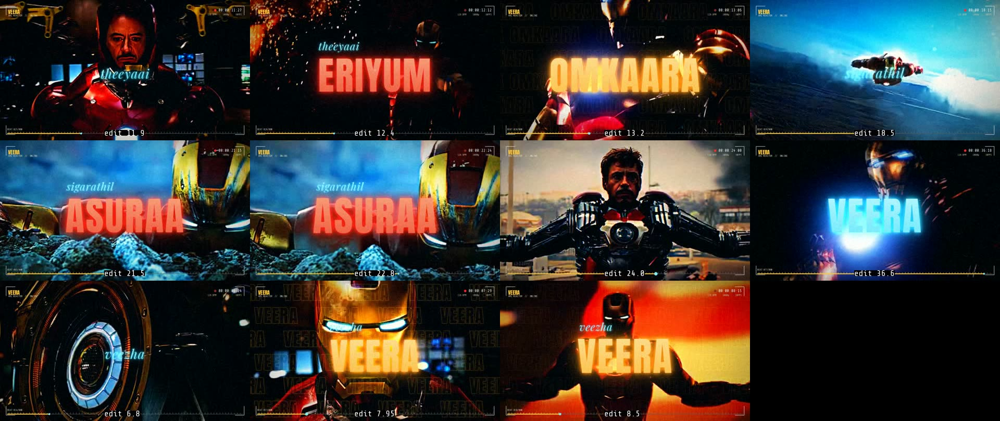
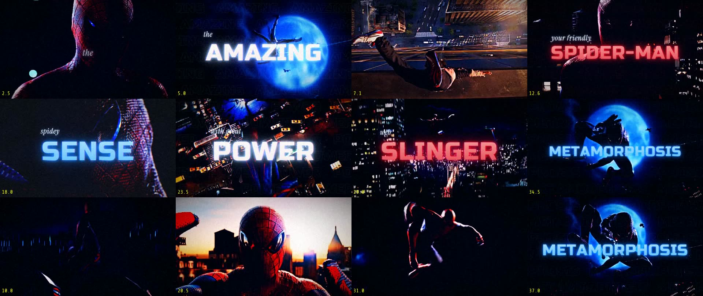
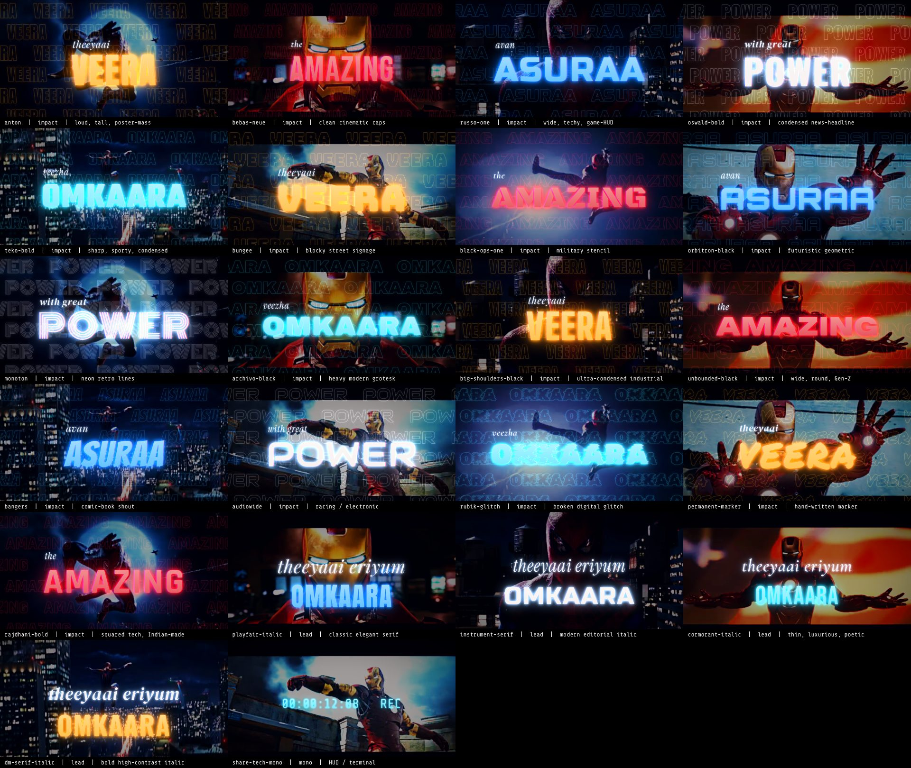
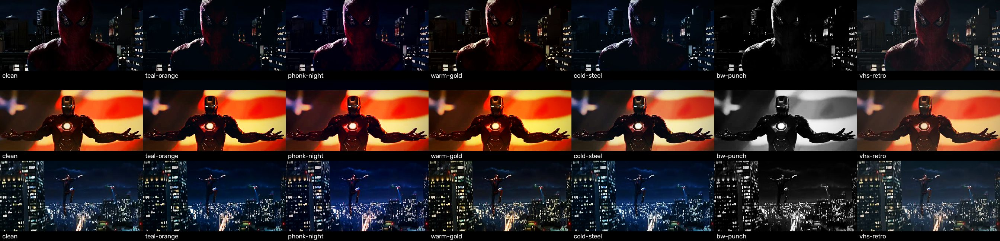

# mass-fan-edit — a Claude skill for beat-synced cinematic fan edits

Turn your own movie clips + a song into a **mass / phonk / lyric fan edit**: the cut lands on every beat, words slam in on the sung syllable or the 808, the picture punches, shakes, ramps and glows. Claude acts as the editor (song window, words, shots, look); Python + FFmpeg on **your PC** does the rendering, so it works even on low usage limits.




## What it does
- **Song analysis** – finds drops, breaks, BPM, the strongest 30–60 s window, beat grid, bass/808 hits, optional vocal map (`analyze_song.py`).
- **Footage analysis** – orientation (landscape / portrait / square / scope), letterbox, scene cuts, small proxies, contact sheets that cost Claude ~1 image per 30 s of footage (`make_sheets.py`).
- **Edit engine** – beat-grid cutting, forced cuts on bass hits, speed ramps, frame-blended slow-mo, zoom punches, camera shake, flash frames, RGB split, film grain, 7 colour grades, glowing kinetic typography with italic lead-ins and echo grids, optional viewfinder HUD, 16:9 / 9:16 / 1:1 / 4:5 / 21:9 output, high-bitrate H.264 (`massedit.py`).
- **22 bundled fonts** (OFL/Apache) with previews and a genre → font guide.
- **Prompt template** (`PROMPT.md`) – pick font, grade, colours, graphics level, words, shots, format in one message.

## Fonts

Full catalogue with mood / best use / pairings: [`references/fonts.md`](references/fonts.md).

## Grades

Presets and intensity knobs: [`references/styles.md`](references/styles.md).

## Install
1. Install **Python 3.10+** (tick *Add to PATH*) and **FFmpeg** (https://www.gyan.dev/ffmpeg/builds/ → add `bin` to PATH).
2. `git clone https://github.com/AFLAHAFI/mass-fan-edit-skill C:\mass-fan-edit`
3. `pip install -r C:\mass-fan-edit\templates\requirements.txt`
4. Add the skill to Claude: zip the repo folder and upload it under *Settings → Capabilities → Skills* (claude.ai), or copy the folder to `~/.claude/skills/mass-fan-edit` (Claude Code).

## Quick start
```
D:\edits\myedit\
   raw\      <- your clips (.mp4 / .mkv / .mov)
   song\     <- the song (.mp3 / .wav)
   PREP.bat  RUN_EDIT.bat   <- copy from templates\, set SKILL_DIR inside
```
1. Run `PREP.bat` → `song_report.txt`, `video_report.txt`, `sheets\*.jpg`.
2. Open Claude, paste the filled template from [`PROMPT.md`](PROMPT.md), attach those files.
3. Save the `project.json` (and `picks.json`) Claude gives you into the folder.
4. Run `RUN_EDIT.bat` → preview, then the final 1080p MP4.

If Claude can reach your folder (Claude Code / desktop app), it runs all of this itself.

## Repo layout
```
SKILL.md                 master instructions Claude reads first (short)
PROMPT.md                prompt template + examples (English + Malayalam guide)
references/              fonts.md, styles.md, techniques.md, project-schema.md, workflow.md
scripts/                 analyze_song.py, make_sheets.py, massedit.py, verify_picks.py, font_previews.py
fonts/                   22 fonts + fonts.json registry + licenses/
templates/               PREP.bat, RUN_EDIT.bat, project.example.json (lyric mass), project.phonk.json, requirements.txt
assets/                  face detector for auto-scan
docs/                    preview images
```

## Legal
Code: MIT (see `LICENSE`). Fonts: their own licences in `fonts/licenses/`. This tool does not ship any film footage or music: use clips and songs you have the right to use, keep edits to fan/personal use and credit the film and the artists. The preview images in `docs/` are small stills used only to show the fonts and grades.
