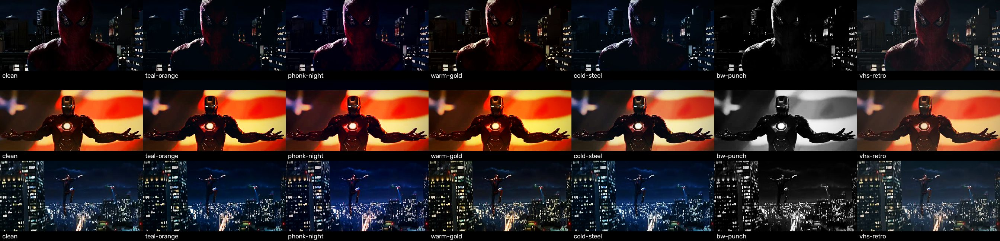

# Looks, grades and genre presets



## Grades (`style.grade`)

| id | Look | Use for |
|---|---|---|
| `clean` | almost untouched, light contrast | daylight, emotional, when footage is already graded |
| `teal-orange` | teal shadows, warm skin/highlights, crushed blacks | classic blockbuster mass edits (Iron Man x Veera) |
| `phonk-night` | dark, neon-blue shadows, crimson kept hot, high saturation | phonk, night swings, cars, villains |
| `warm-gold` | golden, nostalgic, soft blue removed | South-Indian mass, sunset, victory, devotional |
| `cold-steel` | blue-grey, desaturated | war, sad, villain, rain, Batman-style |
| `bw-punch` | black & white, hard contrast | flashback, legacy tribute, intense intros |
| `vhs-retro` | lifted blacks, warm, low contrast | 80s/90s, synthwave, memories |

Grain, vignette and saturation come with the grade. Night footage: prefer `phonk-night`, `clean`, `vhs-retro` (others are darker).

## Intensity knobs (`style`)

| key | default | what it does | typical |
|---|---|---|---|
| `shake` | 1.0 | camera shake on bass hits / word slams | phonk 1.2, emotional 0.3 |
| `zoom` | 1.0 | zoom-punch at each cut | mass 1.0-1.3, calm 0.4 |
| `flash` | 1.0 | white flash on word slams + colour flash on bass hits | 0 = none |
| `chroma` | 1.0 | RGB split on heavy cuts | glitch 2.0 |
| `grain` | 1.0 | film grain | clean 0.4, vhs 1.8 |
| `grid` | 1.0 | echo-grid text strength | 0.6 for busy shots |
| `text_size` | 1.0 | size of all words | long words 0.8 |
| `text_y` | 0.52 | vertical position of words (0 top, 1 bottom) | reels 0.45 |
| `letterbox` | false | 2.39 cinema bars (landscape only) | trailer looks |
| `crop_focus` | [0.5,0.5] | where to crop when aspect changes (x,y) | hero on left → [0.35,0.5] |
| `flash_color` / `hit_flash_color` | white / crimson | hex colours | gold `#FFC040` for mass |
| `lead_color` | white | lead-in italic colour name | `gold` |

## Graphics level (PROMPT.md "GRAPHICS LEVEL") → style knobs

| level | zoom | shake | flash | chroma | grid on | words |
|---|---|---|---|---|---|---|
| minimal | 0.4 | 0.3 | 0.0 | 0.0 | none | 2-4 |
| medium | 0.8 | 0.8 | 0.7 | 0.8 | 2 biggest words | 4-6 |
| heavy | 1.2 | 1.2 | 1.0 | 1.3 | 3-4 words | 5-7 |

Apply the level on top of the preset (level wins for these keys).

## Genre presets (copy into project.json → style)

**`mass-hero`** — Tamil/Malayalam/Telugu hero song
```json
{"grade":"teal-orange","impact_font":"anton","lead_font":"playfair-italic","lead_color":"white","zoom":1.2,"shake":1.0,"flash":1.0,"hit_flash_color":"#FFB020"}
```
Words: gold / red / cyan. Sections: intro (build) → drop (hard cuts every beat) → break (slow-mo + lead word) → drop → outro hold.

**`phonk-night`** — phonk night
```json
{"grade":"phonk-night","impact_font":"russo-one","lead_font":"instrument-serif","shake":1.2,"flash":1.0,"chroma":1.3,"hit_flash_color":"#E61E28"}
```
Words: white / red / blue. Cut on hi-hat grid, slam words on 808 hits.

**`cinematic-trailer`**
```json
{"grade":"cold-steel","impact_font":"bebas-neue","lead_font":"cormorant-italic","zoom":0.6,"shake":0.4,"flash":0.6,"letterbox":true,"grid":0.0}
```

**`emotional`** — love / friendship / sad
```json
{"grade":"warm-gold","impact_font":"permanent-marker","lead_font":"cormorant-italic","zoom":0.4,"shake":0.2,"flash":0.3,"chroma":0.0,"grid":0.0,"grain":0.6}
```
More `break`/`groove` sections, fewer `drop`. Words white/gold, no echo grid.

**`anime-hype`** — anime / Gen-Z
```json
{"grade":"clean","impact_font":"unbounded-black","lead_font":"instrument-serif","zoom":1.3,"shake":1.3,"chroma":1.5,"grid":1.2}
```

**`villain-glitch`**
```json
{"grade":"cold-steel","impact_font":"rubik-glitch","lead_font":"cormorant-italic","chroma":2.0,"shake":1.2,"hit_flash_color":"#C00010"}
```

**`retro-synthwave`**
```json
{"grade":"vhs-retro","impact_font":"monoton","lead_font":"dm-serif-italic","grain":1.8,"chroma":1.2,"zoom":0.7}
```
Add colour `pink` (see fonts.md).

## HUD (optional)
`"hud": {"enabled": true, "title": "VEERA", "sub": "ARC REACTOR // ONLINE", "br": "126 BPM"}` draws a viewfinder frame, REC dot, timecode and beat bar. Off by default (clean reel look).
